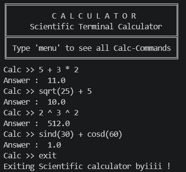
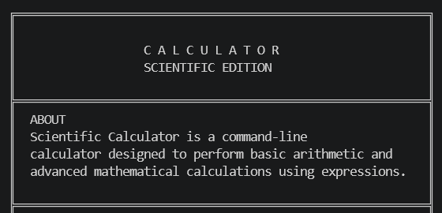
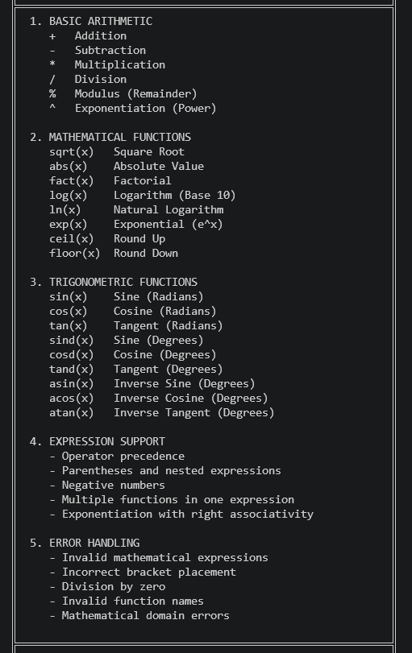
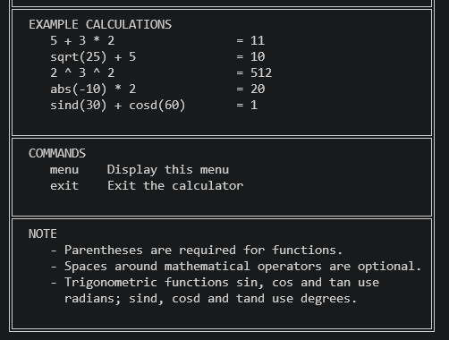

# Scientific Calculator

A Python-based command-line scientific calculator designed to perform basic arithmetic and advanced mathematical calculations through mathematical expressions.

## Features

- Basic arithmetic operations: Addition, Subtraction, Multiplication, Division and Modulus.
- Exponentiation and operator precedence.
- Infix-to-Postfix expression conversion.
- Stack-based postfix expression evaluation.
- Support for parentheses and nested expressions.
- Unary minus and negative numbers.
- Mathematical functions including square root, logarithms, factorial and exponential.
- Trigonometric functions supporting both radians and degrees.
- Inverse trigonometric functions.
- Input validation and error handling.

## Supported Operations

| Category | Operations |
|---|---|
| Arithmetic | `+`, `-`, `*`, `/`, `%`, `^` |
| Mathematical | `sqrt`, `abs`, `fact`, `log`, `ln`, `exp`, `ceil`, `floor` |
| Trigonometry | `sin`, `cos`, `tan` |
| Degree-based Trigonometry | `sind`, `cosd`, `tand` |
| Inverse Trigonometry | `asin`, `acos`, `atan` |

## Screenshots

### 1. Calculations


### 2. Menu


### 3. Menu


### 4. Menu


## Technologies Used

- Python
- Math module
- Regular Expressions
- Stack Data Structure
- Infix-to-Postfix Conversion

## How to Run

1. Install Python 3.
2. Clone this repository.
3. Open the project folder in your terminal.
4. Run:

   ```bash
   python scientific_Cal.py
   ```

## Example Calculations

```text
5 + 3 * 2
sqrt(25) + 5
2 ^ 3 ^ 2
abs(-10) * 2
sind(30) + cosd(60)
```

## Project Status

Completed initial version. More improvements and features may be added in future updates.

## Author

Abhishek Choudhary